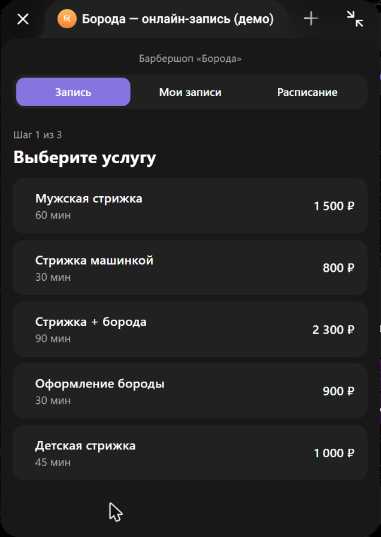
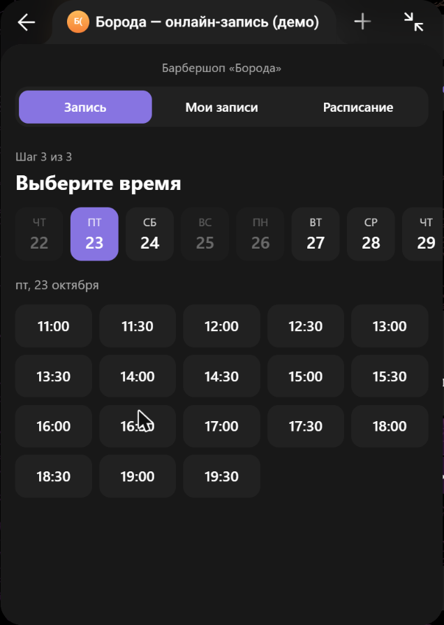
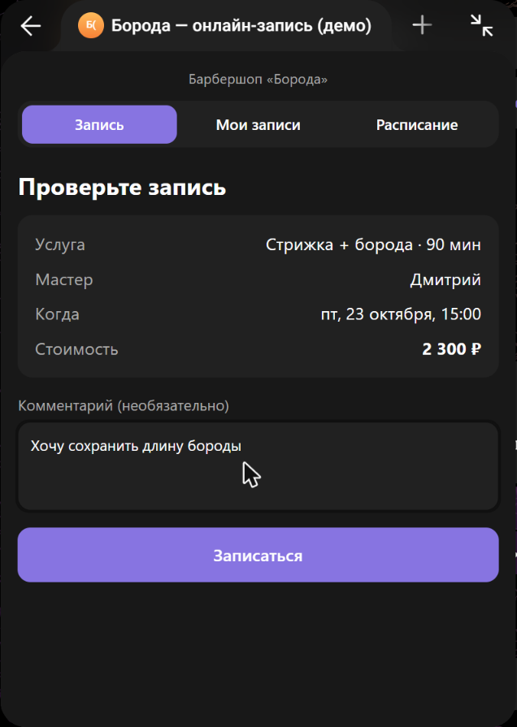
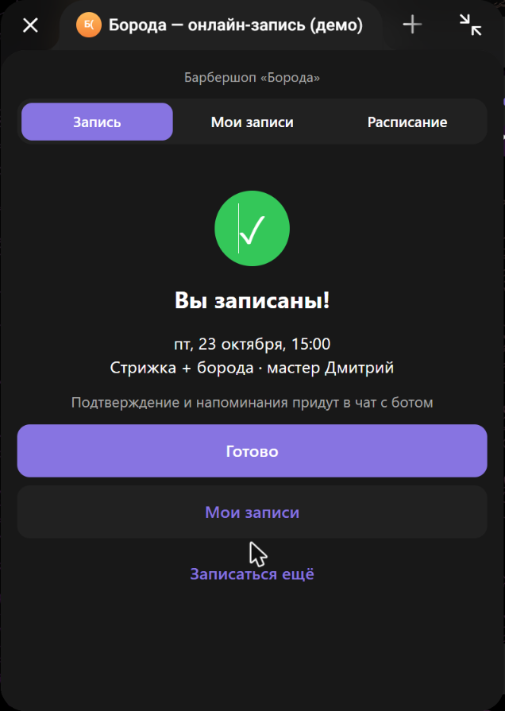
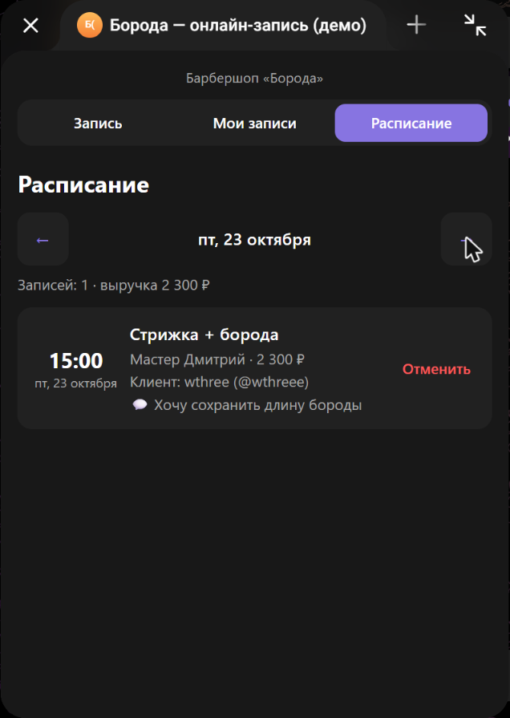
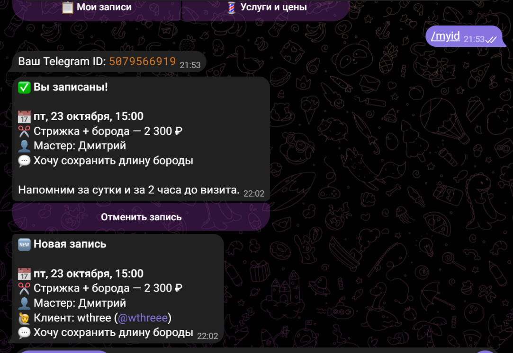

# 📅 Telegram Booking Bot + Mini App

**English** · [Русский](README.ru.md)

An appointment booking system for salons, barbershops, studios and any service business — built entirely inside Telegram. Customers pick a service, a specialist and a free time slot in a Mini App, get a confirmation and reminders, while the admin sees the schedule and gets notified about every booking.

> The demo UI is in Russian (it was built for a Russian-speaking barbershop). All texts live in a few files and can be translated in an hour.

<p>
  
  
  
  
</p>
<p>
  
  
</p>

## Features

**For customers**
- Book in 3 steps inside a Mini App: service → specialist (or "any available") → day and time
- Only truly free slots are shown, based on each specialist's working hours, service duration and existing bookings
- Confirmation in chat plus reminders **24 hours and 2 hours** before the visit
- "My bookings" and cancellation — in the bot or in the Mini App
- The UI follows Telegram's light and dark themes

**For the admin**
- A notification for every new booking and cancellation
- Daily schedule in the Mini App with booking count and revenue
- `/today` and `/tomorrow` commands in the bot
- Cancelling a booking automatically notifies the customer

**Reliability**
- Telegram `initData` signature verification — nobody can send requests on someone else's behalf
- No double booking: the slot is re-checked inside a database transaction
- A limit of active bookings per customer and no last-minute bookings (less than an hour ahead)
- Tests for slot calculation, booking logic and signature verification

## Tech stack

| | |
|---|---|
| Bot | Node.js 24, TypeScript, [grammY](https://grammy.dev) |
| API | Fastify (+ brotli/gzip compression) |
| Database | SQLite (built-in `node:sqlite`, no native dependencies) |
| Mini App | React 19, TypeScript, Vite, Telegram Mini Apps SDK |
| Tests | `node:test` |

## Architecture

```
Customer ──► Telegram bot (grammY) ──┐
   │                                 ├──► booking-service ──► SQLite
   └──► Mini App (React) ──► API ────┘         │
                          (Fastify)            └──► notifications and reminders in Telegram
```

```
server/src/
├── index.ts            # entry point: bot + API + reminders
├── bot.ts              # bot commands, buttons, notifications
├── api.ts              # REST API for the Mini App, serves the built frontend
├── booking-service.ts  # business logic: free slots, creating and cancelling bookings
├── slots.ts            # free time calculation for a specialist
├── telegram-auth.ts    # initData signature verification
├── reminders.ts        # reminders 24 h and 2 h before
├── db.ts               # SQLite schema and queries
└── seed.ts             # demo data: services and specialists
webapp/src/
├── App.tsx             # tabs: book, my bookings, schedule (admin)
├── components/         # booking steps, booking list, schedule
├── api.ts              # API client
└── telegram.ts         # Telegram WebApp SDK wrapper
```

## Quick start

Requires **Node.js 24+**.

1. Create a bot with [@BotFather](https://t.me/BotFather), copy `.env.example` to `.env` and paste the token into `BOT_TOKEN`.
2. Mini Apps only open over HTTPS. For development, start a free tunnel:
   ```bash
   ssh -R 80:127.0.0.1:3000 nokey@localhost.run
   ```
   and put the `https://xxxx.lhr.life` address into `WEBAPP_URL`.
3. Build and run:
   ```bash
   npm install
   npm run build
   npm start
   ```
4. Send `/myid` to the bot, put your ID into `ADMIN_IDS` and restart — you'll get notifications and access to the schedule.

| Command | What it does |
|---|---|
| `npm start` | bot + API + Mini App |
| `npm run dev:server` | the same with auto-restart |
| `npm run dev:webapp` | Vite dev server with hot reload (API proxied to :3000) |
| `npm run build` | build the Mini App |
| `npm test` | server tests |
| `npm run typecheck` | type checking |

## Customizing for a client

- **Services and specialists** — `server/src/seed.ts`
- **Business name and time zone** — `BUSINESS_NAME` and `BUSINESS_TZ` in `.env`
- **Booking rules** (slot step, minimum lead time, booking horizon, booking limit) — constants in `slots.ts` and `booking-service.ts`

Server deployment (VPS + Caddy + systemd) is described in [docs/DEPLOY.md](docs/DEPLOY.md).
